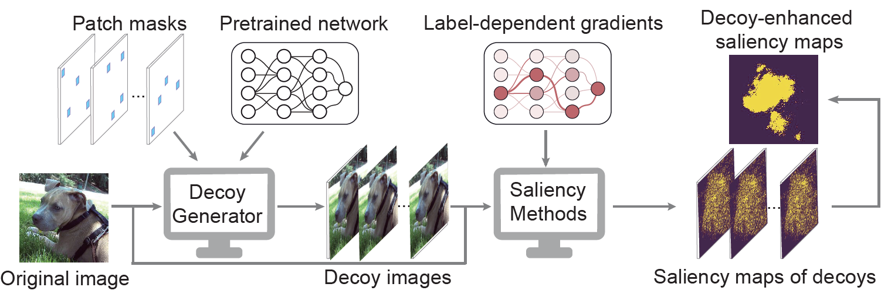

# DANCE: Enhancing saliency maps using decoys

This repo contains the code of the paper titled "DANCE: Enhancing saliency maps using decoys". 
Details are listed below:
 
 

# Overview

we propose a novel saliency method, Decoy-enhANCEd saliency (DANCE), to tackle these limitations. At a high level, DANCE generates the saliency score of an input by aggregating the saliency scores of multiple perturbed copies of this input. Specifically, given an input sample of interest, DANCE first generates a population of perturbed samples, referred to as decoys that perfectly mimic the neural network's intermediate representation of the original input. These decoys are used to model the variation of an input sample originating from either sensor noise or adversarial attacks. 

The decoy construction procedure draws inspiration from the knockoffs, in the setting of error-controlled feature selection, where the core idea is to generate knockoff features that perfectly mimic the empirical dependence structure among the original features.

# Requirements
tensorflow 1.x or keras

# Code details

#### attacks 
Implementation of the adversarial attacks on the saliency methods.

#### classifiers
Implementation of the tensorflow and keras classifiers with some necessaries functions, such as computing activation and gradient. 

#### decoys
Implementation of the optimization-based decoy generation and constant decoy.

#### models 
Network architectures of the ImageNet models, e.g., VGG 16.

#### saliencies
Implementation of the baseline saliency methods. 

#### viz: 
Implementation of visualizing the saliency maps.

#### test 
Implementation of applying decoy-enhanced saliency scores to the three selected datasets. 

# Contact
If you have any questions or suggestions about the code or manuscript, please do not hesitate to contact Yang Lu(`ylu465@uw.edu`)
and Prof. William Noble(`william-noble@uw.edu`). 

# Citation
Y.Y. Lu#, W. Guo#, X. Xin^, W.S. Noble^ (2021). "DANCE: Enhancing saliency maps using decoys". International Conference on Machine Learning (ICML)
